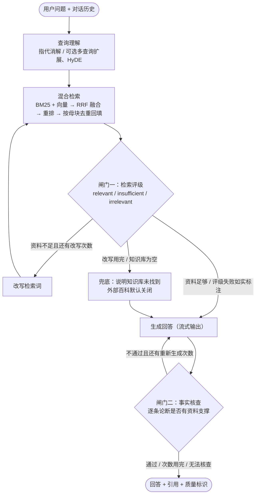

# Agentic RAG 知识库平台

基于 FastAPI + LangGraph 的检索增强问答系统：父子分块、BM25 与向量双路召回、RRF 融合、交叉重排，以及带两道自省检查（检索评级、事实核查）的 Self-RAG 状态机。附带一套可复现的检索评测与端到端评测。

> 本项目经过一轮系统性审查与修复，45 个问题的证据、修复方式和测试见 [`缺陷追踪.md`](缺陷追踪.md)。
> 本 README 只描述代码实际做到的事；做不到或没验证过的地方会直接写明。

---

## 架构



| 模块 | 文件 | 说明 |
|---|---|---|
| 文本抽取 | `app/rag/loaders.py` | txt/md/json 按 UTF-8/GBK 解码；CSV 每行改写为"列名：值"；PDF 逐页抽取并加页码标记，引用卡片显示页码 |
| 父子分块 | `app/rag/splitter.py` | 子块约 300 字用于检索，母块约 1500 字用于生成 |
| BM25 | `app/rag/bm25_index.py` | Okapi BM25；写时复制 + 原子替换，检索与写入可并发 |
| 向量库 | `app/rag/vector_store.py` | Qdrant（连不上时降级为嵌入式内存模式）或纯 numpy 实现 |
| 融合与重排 | `app/rag/rrf_fusion.py`、`reranker.py` | RRF 融合两路名次；重排后按母块去重，重排服务出错时退回 RRF 排序 |
| 知识库管理 | `app/rag/knowledge_base.py` | 以 doc_id 为主键同步管理原文件、BM25、向量库、母块；清单 `data/manifest.json` |
| 后台入库 | `app/rag/ingest_tasks.py` | 上传后立即返回任务 ID，前端轮询解析 / 向量化 / 写入索引三个阶段的进度 |
| 向量缓存 | `app/core/embedding_cache.py` | 以"向量模型标识 + 文本"为键缓存向量（SQLite），重启不重复计费 |
| 状态机 | `app/agent/self_rag_graph.py` | 两道闸门（JSON 输出、失败时标记为"未能完成"）、两套独立重试计数、兜底、质量摘要 |
| 流式输出 | `app/agent/streaming.py` | 用 ContextVar 把生成节点的 token 推给 SSE 接口 |
| 安全 | `app/core/security.py` | 路径白名单、管理接口鉴权、限流 |
| 评测 | `app/eval/pipeline.py`、`experiments/rag_eval.py` | 检索指标、消融实验、端到端评测（见下文） |

---

## 快速开始

```bash
pip install -r requirements.txt
copy .env.example .env      # 填入模型 Key（见下）
python main.py              # 打开 http://127.0.0.1:8000
```

**模型配置**（也可以在网页右上角"设置"里填写）：

| 组件 | 推荐 | 说明 |
|---|---|---|
| 对话模型 | DeepSeek / 通义千问 / OpenAI 兼容接口 | 不配置时使用固定的 Mock 回复，两道闸门不会运行 |
| 向量模型 | 百炼 `text-embedding-v4` | 任何 OpenAI 兼容的 Embedding 接口都可以；不配置时使用**离线哈希特征向量**：只反映词面重叠，没有语义，仅用于把流程跑通 |
| 重排模型 | 百炼 `gte-rerank-v2` | 代码目前只支持百炼的重排接口格式；不配置时使用离线词面打分 |

向量 / 重排的 Key 留空时，只有与对话模型是同一服务商（BASE_URL 域名相同）才会复用对话模型的 Key。例如对话用 DeepSeek、向量用百炼时，必须单独填写百炼的 Key。

**安全相关默认值**：服务只监听 127.0.0.1；修改配置、删除文档、运行评测、连通性测试需要管理权限（设置 `ADMIN_TOKEN` 后需带请求头 `X-Admin-Token`，未设置时只接受本机请求）；问题长度、对话历史、上传大小、请求频率、整次问答耗时都有上限，见 `.env.example`。

---

## 评测

原来的"评测"只是给代码里写死的两条回答打分，不经过系统本身（同样的输入两次跑出 91.9% 和 99.4%），现已替换。

**评测集** `eval_sets/kb_eval_v1.json`：基于两份文档（论文 *Massive Activations in Large Language Models*、一份虚构的差旅报销制度）编写的 43 道题，其中 37 道可回答（含 5 道"中文问英文论文"的跨语言题）、6 道知识库里没有答案。每道可回答题标注了证据原文，用于自动判断检索是否命中。

**运行**：

```bash
python -m experiments.rag_eval                    # 检索评测：Hit@1/3/5、MRR，8 种配置对比，重排阈值分析
python -m experiments.rag_eval --mode full --judge-repeats 2   # 再加端到端：正确性、忠实度、拒答正确率、判官一致率
```

报告保存在 `data/eval/rag_eval_*.md / .json`；网页左侧"运行检索评测"按钮会运行检索评测并展示最近一次结果。

**指标怎么算**：
- 检索指标不依赖 LLM：检索结果（子块或其母块）包含证据原文即算命中；与线上配置做配对 bootstrap，给出差值的 95% 置信区间。
- 端到端指标由 LLM 判官**逐条判断**（是否正确、每条论断是否有资料支撑、是否明确拒答），比例由代码计算；判官温度为 0，可重复多次并报告一致率。

**结果**：见 `缺陷追踪.md` 第 6 组的记录，以最近一次实际运行的报告为准。本 README 不写死任何分数。

**局限**：评测集规模小（43 题），题目由 Claude 根据文档起草，需要人工复核；判官与被测系统可能是同一个模型，存在自评偏差；置信区间很宽时，说明这批题目还不足以区分两种配置。

---

## 测试

```bash
python run_tests.py
```

当前全量自动化测试套件共 **103 项测试全部通过**（0 错误，0 失败，0 跳过，执行耗时约 28 秒），完整测试日志见 [`run_tests_output.txt`](run_tests_output.txt)。

测试使用临时目录和独立的检索器实例，不会改动 `data/` 和 `.env`，也不访问外网。主要测试模块（共 13 个测试套件）：

| 文件 | 覆盖内容 |
|---|---|
| `test_security.py` | 路径穿越、管理接口鉴权、CORS、`.env` 注入、限流、提示词标签转义（14 项） |
| `test_data_consistency.py` | 重复上传、删除、重启重建、PDF、BM25 增量正确性、母块去重（14 项） |
| `test_api_endpoints.py` | FastAPI 端点集成测试、异步任务轮询、评测接口（14 项） |
| `test_agent_flow.py` | 用可编排假 LLM 覆盖状态机分支：评级失败、改写、兜底、重新生成、流式事件（18 项） |
| `test_group7_cache_ingest.py` | 向量磁盘缓存、重启零 API 重建、后台入库进度与失败、PDF 页码、CSV 表头（9 项） |
| `test_eval_pipeline.py` | 指标计算、评测集证据完整性、消融开关、端到端判官、Bootstrap 置信区间（8 项） |
| `test_concurrency_api.py` | 边写边搜、Embedding 分批、重排失败降级、未装 qdrant 时的降级（5 项） |
| `test_key_resolution.py` | 向量 / 重排 Key 的复用规则与运行时热更新（5 项） |
| `test_llm_and_offline.py` | 离线哈希特征向量几何特性、离线重排、网络连通性探测（5 项） |
| `test_hybrid_retrieval.py` | Okapi BM25 稀疏检索、RRF 倒数名次融合加权（3 项） |
| `test_ragas_evaluator.py` | 四维指标与上下文精准度/召回率真实数学覆盖（3 项） |
| `test_splitter.py` | 父子分块与边界重叠率（3 项） |
| `test_self_rag_graph.py` | Self-RAG 端到端状态机运行与生成回复（2 项） |


---

## 已知局限

- 索引在内存中：重启时按清单重新切分并构建 BM25；向量从本地缓存 `data/embedding_cache.sqlite` 读取，不会重复调用 Embedding 接口。
- 后台入库任务的状态只保存在内存中（重启后丢失），只适合单进程部署；多进程部署需要改用 Redis 和任务队列。
- 提示词注入只能缓解（资料用标签包裹、声明资料中的指令无效），无法根除。
- 先流式输出、后做事实核查：用户可能先看到一版未经核查的回答，界面会标出核查结论；不通过时在下方给出修正版。
- 没有多租户与文档级权限控制，不适合直接对公网开放。
- 前端依赖 CDN（Tailwind Play CDN 官方说明仅用于开发）。
